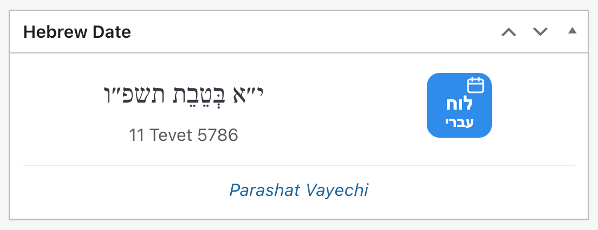

# Hebrew Dates Admin

A WordPress plugin that displays the current Hebrew date in a dashboard widget and a Hebrew Date block.

## Why Hebrew Dates?

I chose to create a Hebrew date widget because the Hebrew calendar is central to Jewish life and practice. Many WordPress users managing Jewish community sites, synagogues, schools, or personal blogs would benefit from seeing the Hebrew date at a glance when they log into their dashboard.

The Hebrew calendar is lunisolar and doesn't align with the Gregorian calendar, making it genuinely useful to have this information readily visible. It's a practical feature that serves a real need while being simple enough to execute well within the project scope.

## Features

- Displays the current Hebrew date in Hebrew characters (e.g., "א׳ בְּטֵבֵת תשפ״ה")
- Shows transliterated date below for accessibility (e.g., "1 Tevet 5785")
- Displays Jewish holidays and events when applicable
- Advances the Hebrew date at the estimated local sunset
- Respects WordPress timezone settings and DST automatically
- Caches successful API responses for up to 24 hours
- Waits 30 seconds before retrying a failed API request for the same date and sunset period

## Screenshot



*The widget displays in the WordPress Admin Dashboard with the Hebrew date prominently shown, transliteration below, and any holidays/events listed.*

## Installation

1. Get a built `hebrew-dates-admin.zip` or build it with the packaging steps below.
2. In WordPress, go to **Plugins → Add New Plugin → Upload Plugin** and upload the ZIP.
3. Activate **Hebrew Dates Admin**.
4. Open the Dashboard to see the widget. In the block editor, search for **Hebrew Date** to add the block.

## Requirements

- WordPress 6.6 or higher
- PHP 8.0 or higher

## AI Tools Used

**Primary Tool**: Claude Code with Claude Opus 4.5 model (claude-opus-4-5-20251101)

### How AI Assisted

- **Project scaffolding**: Created a custom Claude Code skill (`hebrew-dates-dev`) with development workflow, security checklist, and README template
- **API research**: Analyzed Hebcal Developer APIs documentation to identify the best endpoint and response format
- **Architecture decisions**: Evaluated three approaches (Hebcal API, PHP built-in functions, hybrid) and helped select the optimal solution
- **Code generation**: Generated both plugin files with detailed inline comments explaining each section
- **WordPress best practices**: Ensured proper use of WordPress APIs (`wp_remote_get`, `wp_date`, transients, escaping functions)
- **Security implementation**: Applied ABSPATH checks and output escaping throughout
- **Documentation**: Maintained process journal and generated this README

## Development Process

### Overview

The development followed a structured, plan-first approach:

1. **Setup**: Created project repository with Claude Code skill for guided development
2. **Research**: Investigated Hebcal APIs and evaluated implementation approaches
3. **Planning**: Developed detailed implementation plan before writing code
4. **Implementation**: Created plugin files following the plan
5. **Documentation**: Maintained process journal throughout, compiled into README

### What Worked Well

- **Hebcal API**: Provides exactly what we need in one call - Hebrew characters, transliteration, and events
- **24-hour caching**: Using WordPress transients eliminates repeated API calls and provides resilience
- **Separation of concerns**: Keeping API logic in its own class made the main plugin file clean and readable
- **Plan-first approach**: Having a detailed implementation plan meant coding went smoothly with no major pivots
- **Inline documentation**: Comments explaining "why" not just "what" make the code maintainable

### What Didn't Work (Struggles & Solutions)

| Challenge | Solution |
|-----------|----------|
| Initially considered a hybrid approach with PHP `jdtojewish()` fallback | Decided against it to keep code simpler - 24-hour caching provides sufficient resilience |
| Choosing between caching strategies (object cache vs transients) | Selected transients because they work out-of-the-box without requiring external cache setup |
| Deciding on widget styling approach (separate CSS vs inline) | Used inline styles to keep the plugin self-contained with no additional files to manage |

### Key Learnings

1. **WordPress timezone handling**: `wp_date()` respects site timezone settings, unlike PHP's `date()` which uses server timezone
2. **Transients are powerful**: WordPress handles expiration automatically - no cleanup code needed
3. **WordPress HTTP API**: `wp_remote_get()` handles SSL, redirects, and proxy settings correctly - never use `file_get_contents()` for external requests
4. **URL building**: `add_query_arg()` with `esc_url_raw()` is the WordPress way to safely build API URLs
5. **API response structure matters**: Hebcal returns pre-formatted Hebrew strings, eliminating complex formatting logic

## File Structure

```
hebrew-dates-wp-admin/
├── plugin/                        # Distributable plugin (zip this folder)
│   ├── hebrew-dates-admin.php     # Main plugin file
│   ├── includes/
│   │   └── class-hebcal-api.php   # Hebcal API client with caching
│   ├── blocks/                    # Block source
│   ├── build/                     # Generated block files (after npm run build)
│   └── assets/
│       └── icon.svg               # Hebrew calendar icon
├── tests/
│   └── hebcal-api.php              # Date boundary and API regression tests
├── docs/
│   ├── hebrew-date-approaches.md  # Analysis of implementation options
│   ├── implementation-plan.md     # Detailed development plan
│   └── process-journal.md         # Development log
├── README.md                      # This file
└── CLAUDE.md                      # Claude Code project guidance
```

## Packaging for Distribution

From a checkout, run:

```bash
cd plugin
npm ci
npm run package
```

The packaging command builds the block and checks that the files referenced by its metadata exist. It creates `plugin/hebrew-dates-admin.zip` with the compiled block, widget assets, and PHP files.

### Development checks

From the repository root, run:

```bash
php tests/hebcal-api.php
npm --prefix plugin run lint:js
npm --prefix plugin run lint:css
```

The PHP tests use fixed local times and simulated Hebcal responses.

## How It Works

1. **On dashboard load**: Plugin hooks into `wp_dashboard_setup` to register the widget
2. **Widget display**: Callback function instantiates `Hebcal_API` class
3. **Sunset calculation**: Finds the sunset that falls on the site's local calendar date
4. **Cache check**: Class checks for cached data in WordPress transients (separate caches for before/after sunset)
5. **API call** (if needed): Fetches from `https://www.hebcal.com/converter` with current date and sunset flag if applicable
6. **Response parsing**: Extracts Hebrew string, builds transliterated string, captures events
7. **Caching**: Stores successful responses for up to 24 hours and failed responses for 30 seconds
8. **Output**: Renders escaped HTML with Hebrew date, transliteration, and any events

## Location & Sunset Calculation

The plugin estimates sunset using the timezone selected under **Settings → General → Timezone**.

- **Named timezones** use representative coordinates from PHP's timezone database. Use the filters below if you need the sunset for a specific location.
- **UTC offsets** use Jerusalem coordinates by default. The plugin still determines the date and time in the site's configured offset.
- **No local sunset** uses local midnight as the date boundary. This applies during polar day and polar night.

On sites with a full-page cache, the block updates when WordPress next renders the page. Configure the page cache to expire by sunset and local midnight if visitors need the date to change at those times.

### Advanced: Custom Location

For precise control over the sunset calculation location, you can use WordPress filters:

```php
// Set exact coordinates (e.g., for a specific synagogue location)
add_filter( 'hebrew_dates_admin_latitude', function() {
    return 40.7128; // New York City
});

add_filter( 'hebrew_dates_admin_longitude', function() {
    return -74.0060;
});
```

## Security

This plugin follows WordPress security best practices:

- **Direct access prevention**: All PHP files check for `ABSPATH` constant
- **Output escaping**: All displayed content uses `esc_html()`
- **Safe HTTP requests**: Uses WordPress HTTP API (`wp_remote_get`)
- **No user input**: Widget is display-only with no form processing
- **Minimal attack surface**: No database queries, no file operations, no user-submitted data

## Credits

- **Hebrew date data**: [Hebcal Jewish Calendar API](https://www.hebcal.com/home/developer-apis) (Creative Commons Attribution 4.0)

## License

GPL-2.0 or later

## Author

Paul Jacobson

---

*Built with [Claude Code](https://claude.ai/code) using Claude Opus 4.5 (claude-opus-4-5-20251101)*
